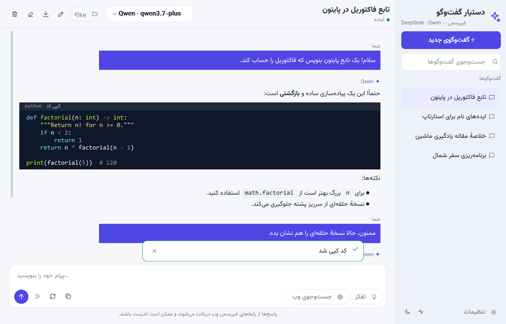
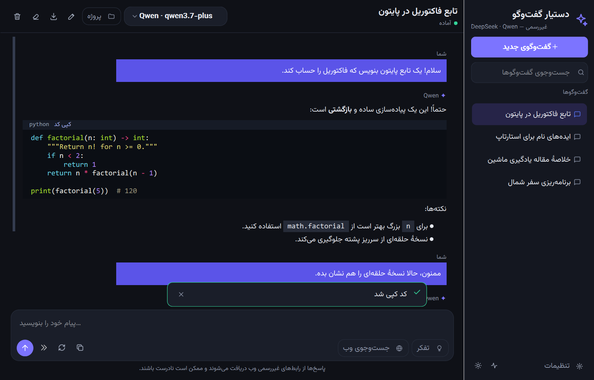
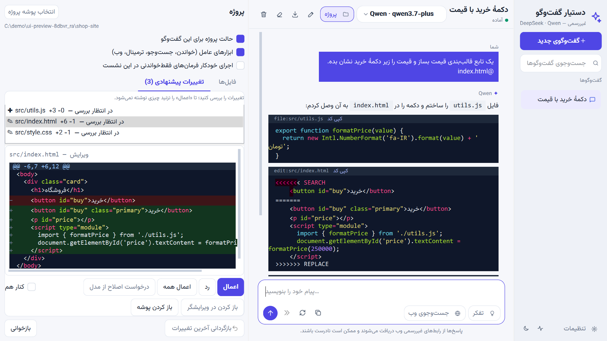
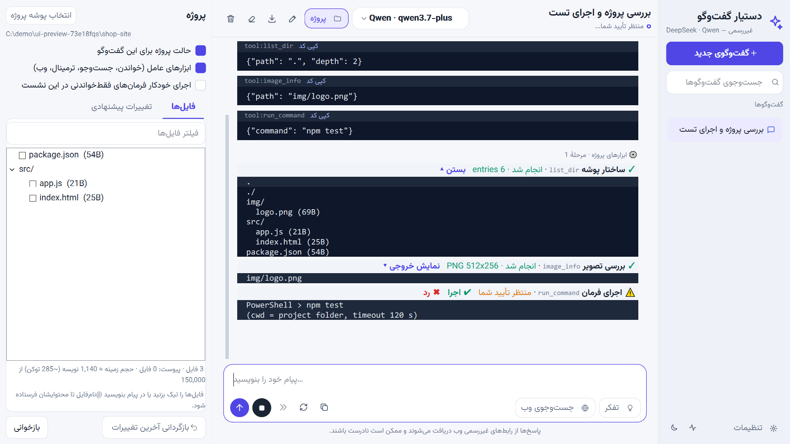
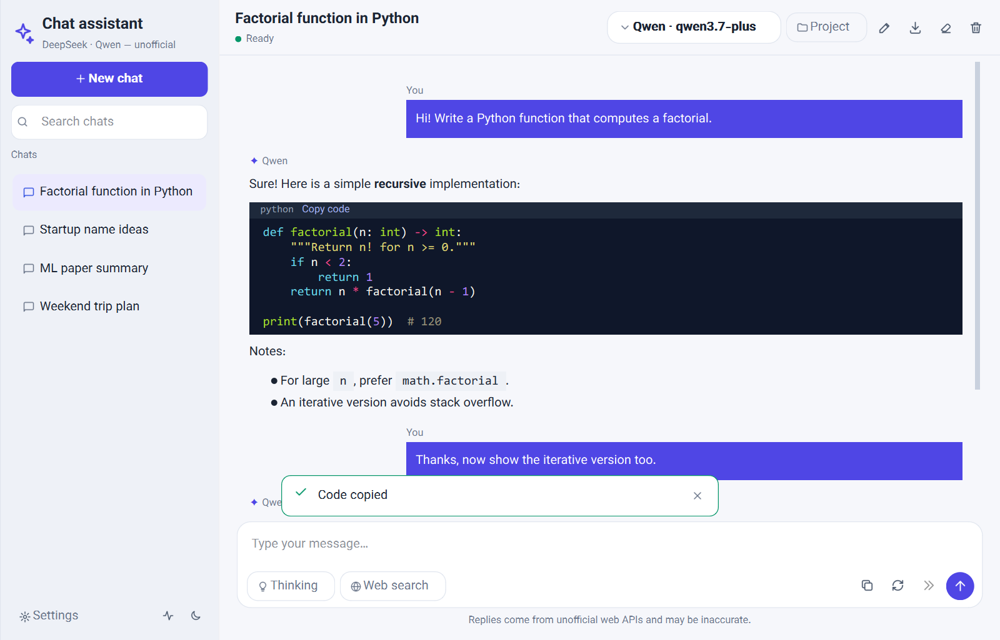
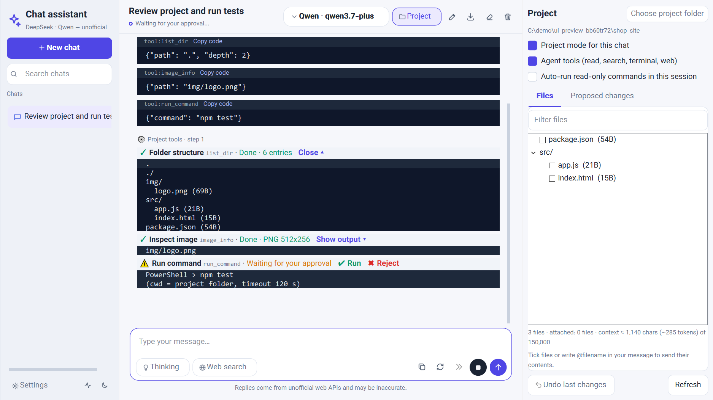

<div align="center" dir="rtl">

# Qwen و DeepSeek دسکتاپ

**دستیار برنامه‌نویسی هوش مصنوعی رایگان و متن‌باز برای ویندوز: گفت‌وگو با Qwen و DeepSeek در یک برنامه، نوشتن کامل کد داخل چت، و ویرایش فایل‌های پروژه با بازبینی تغییرات.**

[](https://github.com/amirreza-fnt/qwen-deepseek-desktop/actions/workflows/tests.yml)
[](LICENSE)


[English](README.md) · **فارسی**



</div>

<div dir="rtl">

> **پروژهٔ غیررسمی.** این برنامه هیچ وابستگی‌ای به DeepSeek، Alibaba Cloud یا Qwen ندارد و از سوی آن‌ها تأیید نشده است. برنامه با **نشست وب حساب خودتان** به نسخهٔ وب این سرویس‌ها وصل می‌شود. لطفاً [سلب مسئولیت](#سلب-مسئولیت) را بخوانید.

## چرا؟

نسخهٔ وب Qwen و DeepSeek در برنامه‌نویسی عالی‌اند، اما کپی کردن مداوم کد بین چت و ویرایشگر وقت‌گیر است. این برنامه هر دو مدل را در یک پنجرهٔ دسکتاپ جمع می‌کند و چیزهایی را که یک دستیار برنامه‌نویسی لازم دارد اضافه می‌کند: نوشتن کامل و خط‌به‌خط کد داخل خود چت، **حالت پروژه** که در آن مدل تغییر فایل‌ها را پیشنهاد می‌دهد و شما آن‌ها را به‌صورت diff بازبینی می‌کنید، و **ابزارهای عامل** (خواندن و جست‌وجوی فایل، اجرای فرمان، دانلود، درخواست به API) که فقط با تأیید شما اجرا می‌شوند.

## امکانات

- 🤖 **Qwen و DeepSeek در یک برنامه**: سرویس و مدل هر گفت‌وگو را جدا انتخاب کنید. فهرست مدل‌های Qwen را می‌توانید از تنظیمات و از خود سایت به‌روز کنید.
- 🌐 **ورود با مرورگر داخلی**: یک بار در مرورگر داخلی (QtWebEngine) وارد chat.qwen.ai شوید. ورود یا تأیید را خودتان انجام می‌دهید و نشست در یک پروفایل محلی می‌ماند.
- ⚡ **کد کامل داخل چت**: پاسخ‌های خیلی طولانی (ده‌ها هزار نویسه) روان و تدریجی نمایش داده می‌شوند، با رنگ‌آمیزی کد و دکمهٔ «کپی کد».
- 📁 **حالت پروژه با بازبینی diff**: مدل فایل کامل، ویرایش SEARCH/REPLACE یا حذف پیشنهاد می‌دهد. شما diff را عادی یا «کنار هم» می‌بینید و «اعمال» را می‌زنید. از هر نوشتنی نسخهٔ پشتیبان گرفته می‌شود و می‌توانید آن را بازگردانی کنید.
- 🛠️ **ابزارهای عامل با تأیید شما**: دیدن ساختار پوشه، یافتن و جست‌وجو و خواندن فایل‌ها و بررسی تصویرها خودکار و فقط *داخل پوشهٔ پروژه* انجام می‌شود. فرمان‌های ترمینال (PowerShell یا cmd)، دانلود و درخواست به نشانی‌های بیرونی روی یک کارت نشان داده می‌شوند و فقط با زدن «اجرا» اجرا می‌شوند.
- ✂️ **ابزارهای ویرایش کم‌مصرف**: جابه‌جا یا کپی کردن بازهٔ خطوط بین فایل‌ها، جایگزینی خطوط، جست‌وجو و جایگزینی (حتی با regex) در چند فایل، تغییر نام و جابه‌جایی مسیرها همراه با اصلاح importها (JS/TS، CSS، HTML، PHP، C/C++، Python، Java، Go) و اعمال patch، بدون اینکه مدل کد را دوباره تایپ کند.
- 🎨 **پوستهٔ روشن و تیره** با قلم وزیرمتن.
- 🌍 **رابط دوزبانهٔ English و فارسی**: چیدمان کامل راست‌به‌چپ برای فارسی و چپ‌به‌راست برای انگلیسی. زبان پیش‌فرض از زبان سیستم گرفته می‌شود.
- 🔐 **حریم خصوصی**: توکن‌ها در مدیر اعتبارنامهٔ ویندوز ذخیره می‌شوند. گزارش‌ها پاک‌سازی می‌شوند و توکن، کوکی، ایمیل یا متن پیام در آن‌ها نوشته نمی‌شود. تاریخچهٔ گفت‌وگو هم فقط روی کامپیوتر خودتان می‌ماند.

## تصاویر

| فارسی · روشن | فارسی · تیره |
|---|---|
|  |  |
| **حالت پروژه: بازبینی diff پیش از نوشتن** | **ابزارهای عامل: فرمان‌ها تأیید می‌خواهند** |
|  |  |
| **English · Light** | **English · Agent tools** |
|  |  |

## نصب

### روش ۱: نسخهٔ آمادهٔ ویندوز (بدون نیاز به پایتون)

آخرین فایل zip را از بخش [**Releases**](https://github.com/amirreza-fnt/qwen-deepseek-desktop/releases) دانلود کنید، **کل پوشه** را از حالت فشرده خارج کنید و `DeepSeekDesktop-Stable.exe` را اجرا کنید.

### روش ۲: اجرا از سورس (pip)

به پایتون ۳.۱۱ یا جدیدتر نیاز دارید. ویندوز ۱۰ یا ۱۱ پیشنهاد می‌شود.

</div>

```bash
git clone https://github.com/amirreza-fnt/qwen-deepseek-desktop.git
cd qwen-deepseek-desktop
python -m venv .venv
.venv\Scripts\activate
pip install -r requirements.txt
python main.py
```

<div dir="rtl">

### روش ۳: ساختن exe

فایل `build.bat` را اجرا کنید. خروجی در `dist\DeepSeekDesktop-Stable\DeepSeekDesktop-Stable.exe` ساخته می‌شود. کل پوشه را کپی کنید. حجم آن حدود ۴۵۰ مگابایت است، چون مرورگر داخلی (QtWebEngine) همراهش است.

## روش استفاده

1. **Qwen (پیشنهادی):** در *تنظیمات ← سرویس‌ها*، **Qwen** را با روش اتصال **مرورگر داخلی** انتخاب کنید. روی «ورود / تأیید Qwen در مرورگر داخلی» بزنید، وارد حساب خودتان شوید و «ادامه» را بزنید. Qwen ممکن است در بعضی مناطق محدود باشد. فقط جایی از آن استفاده کنید که برایتان در دسترس است.
2. **DeepSeek:** توکن نشست وب حساب خودتان را در *تنظیمات ← DeepSeek* وارد کنید. هرگز گذرواژه وارد نکنید.
3. پیام را بنویسید. **Enter** ارسال می‌کند و **Shift+Enter** خط جدید می‌سازد.
4. **حالت پروژه:** روی «پروژه» بزنید و پوشه را انتخاب کنید. فایل‌ها را تیک بزنید یا با `@نام‌فایل` نام ببرید. تغییرات را در «تغییرات پیشنهادی» ببینید و «اعمال» یا «بازگردانی آخرین تغییرات» را بزنید.
5. **ابزارهای عامل:** گزینهٔ «ابزارهای عامل» را روشن بگذارید. جست‌وجو و خواندن خودکار انجام می‌شود، ولی فرمان، دانلود و درخواست بیرونی منتظر «✔ اجرا» یا «✖ رد» می‌مانند.
6. **زبان:** از *تنظیمات ← ظاهر ← زبان*، یکی از گزینه‌های پیش‌فرض سیستم، English یا فارسی را انتخاب کنید. تغییر زبان پس از راه‌اندازی دوبارهٔ برنامه اعمال می‌شود.

## پرسش‌های رایج

**رایگان است؟** خود برنامه رایگان است و مجوز MIT دارد. برنامه از چت وب رایگان هر سرویس با حساب خودتان استفاده می‌کند، پس محدودیت‌ها و قوانین همان سرویس برقرار است.

**کپچا یا محدودیت‌ها را دور می‌زند؟** خیر. اگر سایت تأیید بخواهد، خودتان آن را در مرورگر داخلی انجام می‌دهید. برنامه کپچا حل نمی‌کند، امضای ضدربات جعل نمی‌کند و کوکی‌ها را جایی منتقل نمی‌کند.

**برنامهٔ رسمی Qwen یا DeepSeek است؟** خیر، یک برنامهٔ مستقل و غیررسمی است. رابط‌های خصوصی وب هر لحظه ممکن است تغییر کنند.

**داده‌هایم کجا ذخیره می‌شوند؟** گفت‌وگوها بدون رمزنگاری در `%LOCALAPPDATA%\DeepSeekDesktop\history.sqlite3` ذخیره می‌شوند و توکن‌ها در مدیر اعتبارنامهٔ ویندوز.

**مدل می‌تواند فایل‌هایم را پاک کند یا هر چیزی اجرا کند؟** خیر. تغییرات تا وقتی «اعمال» را نزنید فقط پیشنهادند و نسخهٔ پشتیبان و امکان بازگردانی دارند. مسیرها هم محدود به پوشهٔ پروژه‌اند و فرمان‌ها و دانلودها با کلیک شما اجرا می‌شوند.

## سلب مسئولیت

این یک پروژهٔ **غیررسمی** و مستقل است و هیچ وابستگی‌ای به **DeepSeek، Alibaba Cloud یا Alibaba Group و تیم Qwen** ندارد و از سوی آن‌ها تأیید یا حمایت نشده است. نام‌ها و نشان‌های تجاری متعلق به صاحبانشان است و فقط برای توضیح سازگاری آمده‌اند. برنامه از نشست وب **حساب خود شما** و رابط‌های خصوصی و مستندنشده استفاده می‌کند که ممکن است هر زمان تغییر کنند یا از کار بیفتند. رعایت **قوانین استفاده (ToS)** هر سرویس و قوانین کشورتان بر عهدهٔ خودتان است. برنامه کپچا، محدودیت تعداد درخواست یا محدودیت منطقه‌ای را دور **نمی‌زند**. نرم‌افزار «همان‌گونه که هست» و بدون هیچ ضمانتی ارائه می‌شود.

## مشارکت

از گزارش مشکل، ترجمه و Pull Request استقبال می‌شود. راهنما در [CONTRIBUTING.md](CONTRIBUTING.md) است.

## مجوز

[MIT](LICENSE) © amirreza-fnt. قلم وزیرمتن با مجوز SIL OFL 1.1 همراه برنامه است.

---

⭐ اگر این برنامه به کارتان آمد، با ستاره دادن به دیده شدنش کمک کنید.

</div>
